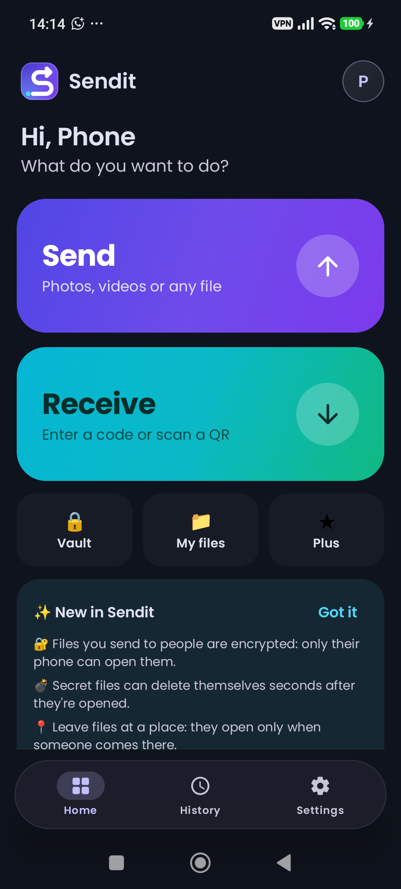
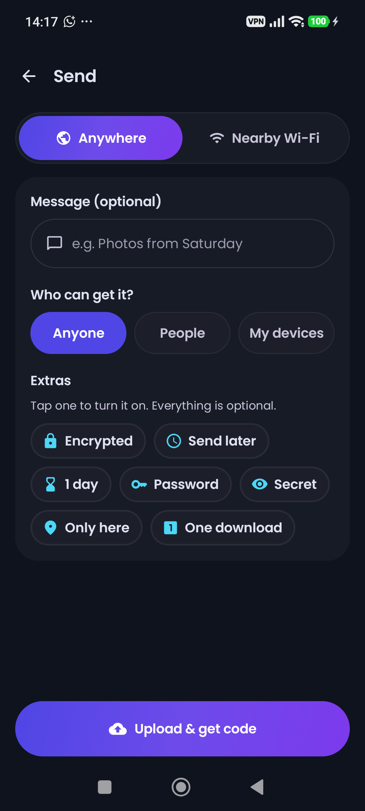
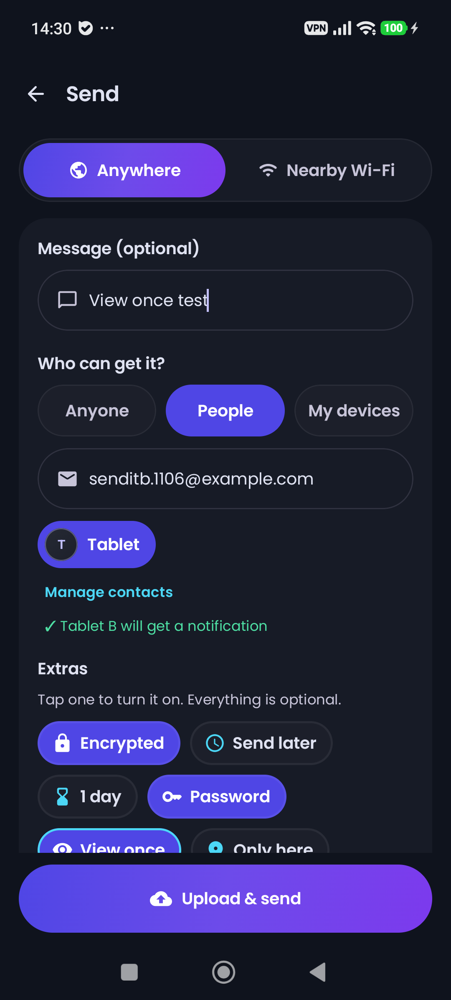
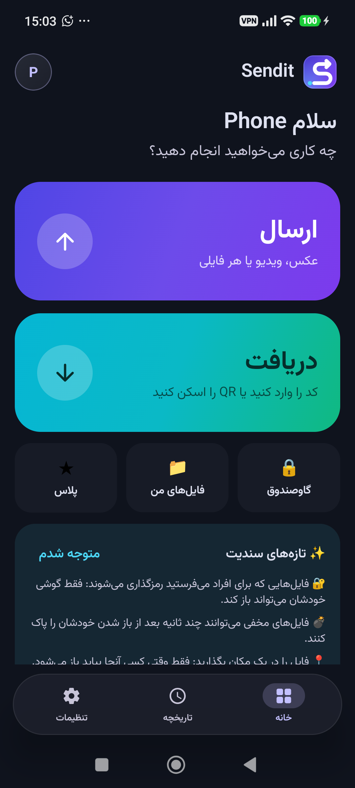
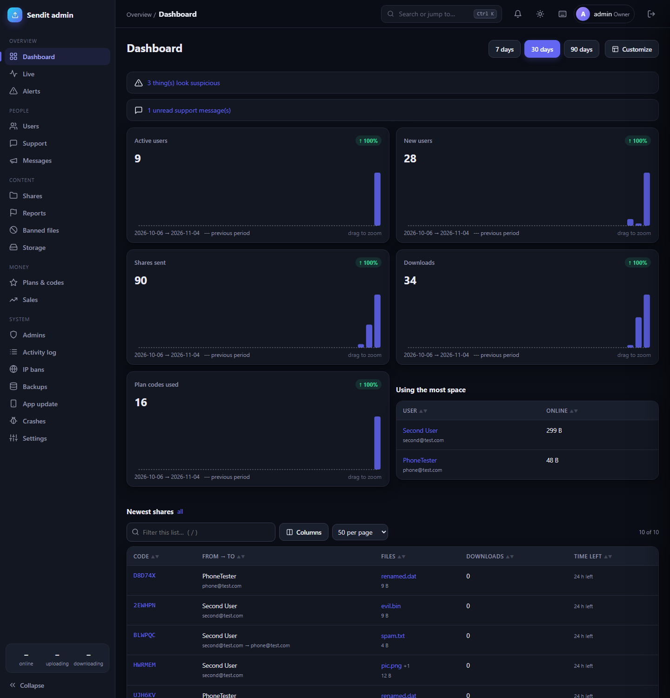
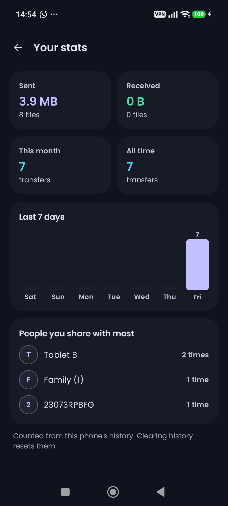
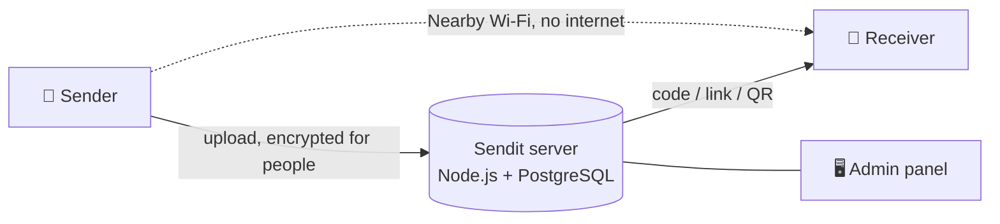

<div align="center">


# Sendit

**Send any file to anyone, anywhere — with a 6-character code.**

Pick a photo, a video or a whole folder, get a code, and the other person types it in.<br>
Codes work in the app or in any browser, and files you send to people are end-to-end encrypted.

[](https://github.com/Ariyan-Ebrahimi/sendit/releases/latest)


<br>

&nbsp;
&nbsp;
&nbsp;


</div>

---

## ✨ What it can do

<table>
<tr>
<td width="50%" valign="top">

### 🚀 Sending
- **Anywhere** — upload once, share a code, link or QR
- **Nearby Wi-Fi** — phone to phone with no internet, or through the phone's own hotspot
- **People & groups** — send straight to contacts; they get a notification
- **My devices** — move files between your own phones
- Whole folders, camera photos/videos and quick text notes
- Resumable uploads and downloads, pause and continue

</td>
<td width="50%" valign="top">

### 🔐 Privacy
- **End-to-end encryption** (AES-256-GCM + P-256 ECDH) — not even the server can open files sent to people
- **Secret files** — view once, or self-destruct seconds after opening; screenshots blocked
- **Password** and **one download only** links
- **Only here** — files open only at a chosen place
- **Vault** with its own PIN, and app lock with fingerprint

</td>
</tr>
<tr>
<td valign="top">

### 🗂️ Everyday comfort
- Send later at a set time
- Auto-receive from trusted contacts
- Request files from anyone through a web upload page
- File gallery, history, stats and “who downloaded it”
- Home-screen widget and app shortcuts
- Dark & light theme, English / Persian / Turkish

</td>
<td valign="top">

### 🛠️ Admin panel
- Live dashboard with charts, alerts and a notification bell
- Users, shares, reports, banned files and IP bans
- Plans & voucher codes, sales, storage
- Support inbox with saved replies, broadcasts
- Roles (owner / moderator / support), activity log, backups
- Command palette (Ctrl+K), works on phones too

</td>
</tr>
</table>

<div align="center">
&nbsp;

</div>

---

## 📦 Install

Download the latest **`Sendit.apk`** from [Releases](https://github.com/Ariyan-Ebrahimi/sendit/releases/latest) and open it on your phone (Android 8.0 or newer). You may need to allow “Install unknown apps” for your browser.

---

## 🧱 How it's built

```
sendit/
├── sendit/     Android app — Kotlin, Jetpack Compose, Media3, WorkManager
└── server/     Relay server — Node.js, Express, PostgreSQL + admin panel at /admin
```



- Files sent to **Anyone** are stored on the server until they expire (1 hour – 30 days).
- Files sent to **People** are encrypted on the phone; the key travels only inside the link (`#k=…`), never to the server.
- **Nearby Wi-Fi** runs a tiny HTTP server on the sending phone, found with NSD or a QR code.

---

## 🔧 Build it yourself

**App**

1. Add your server address to `sendit/local.properties` (this file is never committed):
   ```properties
   sendit.serverUrl=http://your-server:4000
   ```
   Without it the app uses `http://10.0.2.2:4000` (your PC, seen from the Android emulator).
2. Build:
   ```bash
   cd sendit
   ./gradlew assembleRelease
   ```
   The APK lands in `sendit/app/build/outputs/apk/release/`.

**Server**

On a fresh Ubuntu/Debian VPS, `server/deploy/setup-vps.sh` installs Node.js and PostgreSQL, creates the database, generates every secret and starts a systemd service. Full guide: [server/README.md](server/README.md).

---

<div align="center">

Made with 💜 by [Ariyan Ebrahimi](https://github.com/Ariyan-Ebrahimi)

</div>
